# Perennia on NEAR — Hackathon Plan

> **Everlasting options, deposited from any chain, priced and hedged by a verifiable AI agent running in secure hardware (TEE), with settlement on a NEAR smart contract.**

| | |
|---|---|
| **Hackathon** | [NEAR Hackathon](https://nearhackathon.com/), "Build what's next" |
| **Build window** | Nov 1, 2026 00:00 UTC to **Nov 14, 2026 23:59 UTC** |
| **Judging** | Nov 16–18 (human jury, plus Claude Code & Codex as AI judges) |
| **Primary track** | Unstoppable DeFi |
| **Secondary tracks** | AI Security & Defense, Agent Economy |
| **Prize target** | Track 1st place ($10K) and the Grand Prize ($55K) |

---

## Table of contents

1. [Eligibility: resolve this first](#1-eligibility-resolve-this-first)
2. [Where we are today](#2-where-we-are-today)
3. [Why the NEAR version is different](#3-why-the-near-version-is-different)
4. [System architecture](#4-system-architecture)
5. [Core flows](#5-core-flows)
6. [Smart contract design](#6-smart-contract-design)
7. [Off-chain agent design](#7-off-chain-agent-design)
8. [Frontend changes](#8-frontend-changes)
9. [Scope tiers](#9-scope-tiers)
10. [Timeline](#10-timeline)
11. [Judging strategy](#11-judging-strategy)
12. [Risks and mitigations](#12-risks-and-mitigations)
13. [Submission checklist](#13-submission-checklist)

---

## 1. Eligibility: resolve this first

The hackathon rules say: **"Projects must be built during the hackathon period."**

Perennia already exists as a Solana/Pacifica project (it was a Pacifica hackathon entry). Submitting a port of it risks disqualification, and the AI judges will read the git history.

**Plan:**

- [ ] Ask the organizers before Oct 31 whether you can extend an existing project.
- [ ] Create a **fresh public repo on Nov 1**. Don't import the old git history.
- [ ] Treat the pricing math (`core/`, `perennia_math/`) as **disclosed prior work** in the README, or rewrite it in the new repo.
- [ ] Before Nov 1, do only research, accounts and design. No repo code.

---

## 2. Where we are today

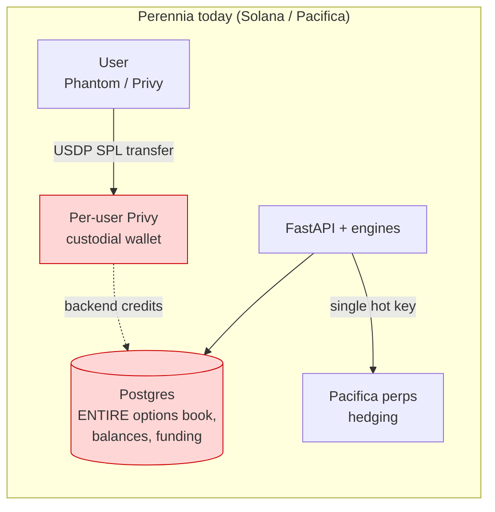

| Layer | Size | Status | Reuse on NEAR |
|---|---|---|---|
| `core/` + `perennia_math/` (Rust) | ~1.8k Python, ~2.1k Rust | Real, pure math: BS, 50-term everlasting series, vol surface, 12-scenario margin model | **High.** The Rust kernel compiles to wasm once pyo3 and rayon are behind a feature flag |
| `engine/` | ~5.6k | Real loops for quotes, risk, orders, funding, hedging | **High.** The hedge engine is tied to Pacifica through only 3 calls |
| `api/` + `db/` | ~5.6k | Real, but **all settlement is off-chain** | Partial. The read APIs stay; custody moves on-chain |
| `exchange/` | ~2.9k | Pacifica + Solana + Privy specific | **Replace** |
| Frontend | ~8k TS | Real chain, order, strategy and payoff UI | Components stay; the wallet layer is replaced |
| Smart contracts | none | — | **Build new** |

**The weakness to fix:** today Perennia is a centralized exchange with a crypto deposit address. The NEAR version moves trust from the server to **the chain and verifiable hardware**.

---

## 3. Why the NEAR version is different

My searches found no options protocol on NEAR, and certainly no everlasting options. Each NEAR feature below maps to a judging point:

| # | Feature | NEAR technology | Why judges care |
|---|---|---|---|
| 1 | On-chain vault and settlement, off-chain pricing (RFQ) | Rust contract, `env::ed25519_verify` | Funds are never custodial |
| 2 | Options as tokens | **NEP-245** multi-token (one token id per series) | Positions are composable: transfer them, use them as collateral, build vaults on top |
| 3 | Verifiable market maker | **Shade Agent** + **TEE attestation** | Anyone can verify that the market maker runs the published code |
| 4 | Hedging with no hot key | **Chain Signatures** (MPC) to Hyperliquid | The vault hedges its own delta on another chain |
| 5 | Deposits from any chain | **NEAR Intents / 1Click API** | Deposit BTC, ETH or SOL; it arrives as USDC in the vault |
| 6 | Permissionless funding and liquidation | Keeper-callable contract methods | Removes the "server must stay up" assumption |
| 7 | Bounded agent permissions | **Function Call Keys** with allowances | An AI vault agent can only call `trade`, with a spending cap |
| 8 | AI strategy copilot (stretch) | **NEAR AI Cloud** private inference | Turns plain language into an options strategy |

---

## 4. System architecture

### 4.1 High-level view

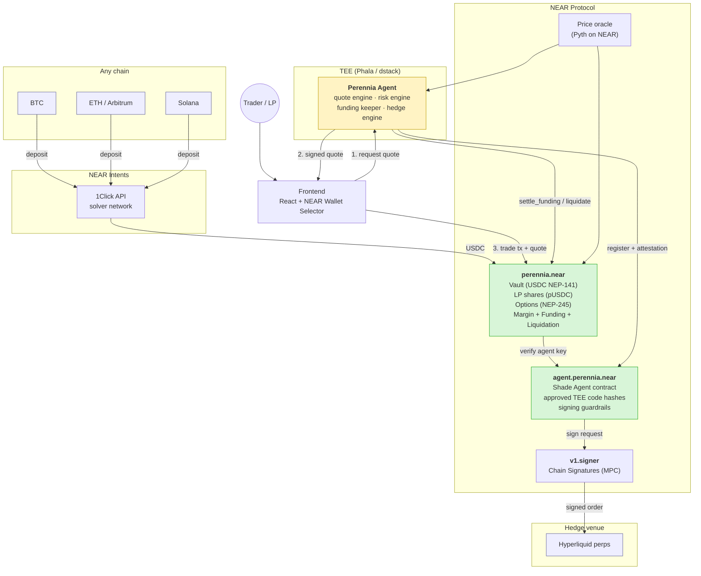

### 4.2 Trust boundaries

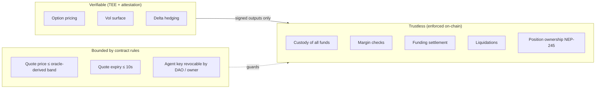

### 4.3 Repository layout (new repo)

```
perennia-near/
├── contracts/
│   ├── perennia/          # main vault + options + margin contract (Rust, near-sdk)
│   ├── agent/             # Shade Agent contract (attestation + chain-sig gate)
│   └── math/              # no_std fixed-point port of perennia_math
├── agent/                 # off-chain engine (Python or TS) running inside the TEE
│   ├── pricing/           # everlasting pricing, vol surface
│   ├── quoter/            # RFQ server: signs quotes
│   ├── keeper/            # funding + liquidation caller
│   └── hedger/            # chain-signature → Hyperliquid
├── frontend/              # React + Vite + NEAR Wallet Selector
├── tests/                 # near-workspaces integration tests
└── README.md              # architecture, threat model, run instructions
```

---

## 5. Core flows

### 5.1 Deposit from any chain (NEAR Intents)

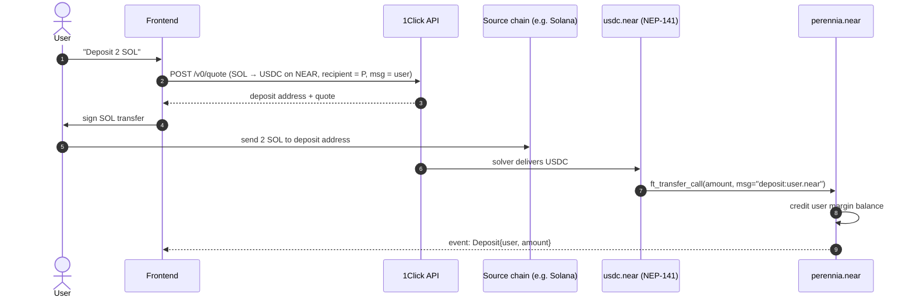

### 5.2 Trade (RFQ with signed quote)

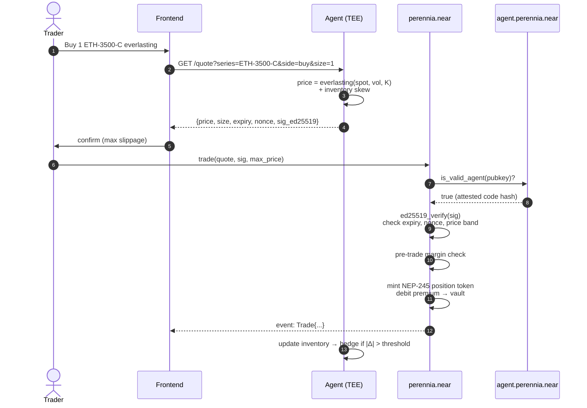

### 5.3 Hourly funding (permissionless keeper)

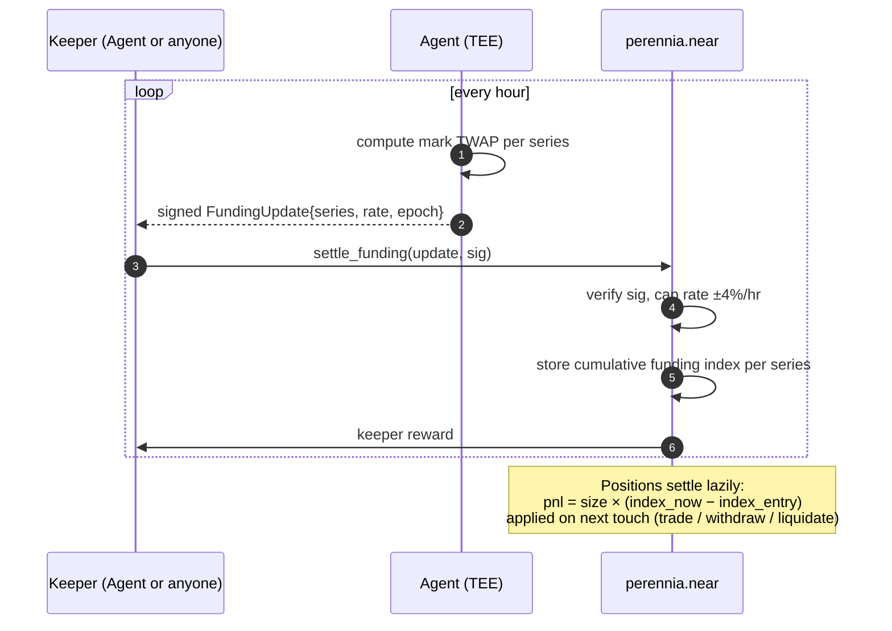

### 5.4 Delta hedging through Chain Signatures

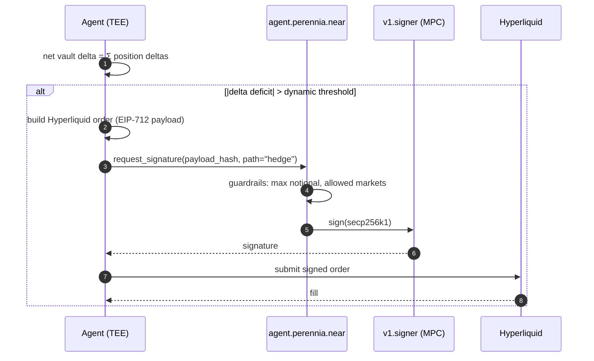

### 5.5 Liquidation

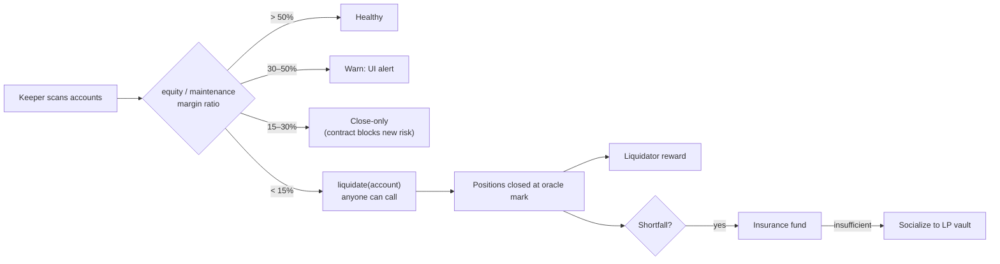

---

## 6. Smart contract design

### 6.1 `perennia.near` storage

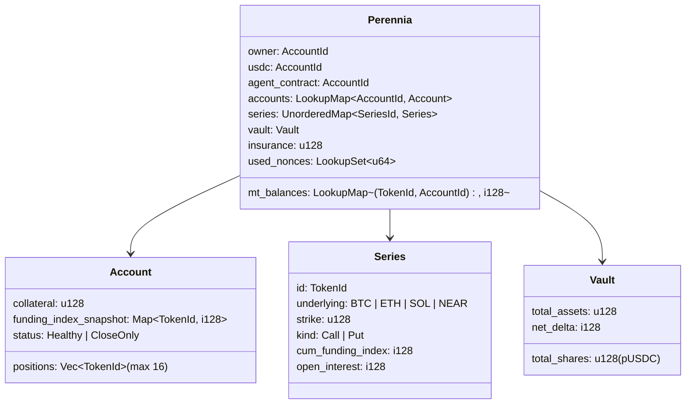

### 6.2 Public methods

| Method | Caller | Purpose |
|---|---|---|
| `ft_on_transfer(sender, amount, msg)` | `usdc.near` | `deposit:<acct>` (trader margin) or `lp` (mint pUSDC) |
| `withdraw(amount)` | trader | Withdraw free collateral (margin check) |
| `lp_redeem(shares)` | LP | Burn pUSDC for USDC (cooldown) |
| `trade(quote, sig, max_price)` | trader / FC-key agent | Execute a signed RFQ quote |
| `settle_funding(update, sig)` | anyone | Post the hourly funding index; earns a reward |
| `liquidate(account)` | anyone | Liquidate an unhealthy account; earns a reward |
| `add_series(...)` | owner / DAO | List a new strike |
| `mt_transfer`, `mt_balance_of`, ... | anyone | NEP-245 standard |
| `get_account`, `get_margin`, `get_series` | view | For UI and indexers |

### 6.3 Contract math rules

- **Money:** all `u128`/`i128` fixed-point (USDC 6 decimals; prices 1e8). The old code used floats for money; don't repeat that.
- **On-chain margin:** a simplified SPAN with ±15% spot × 3 vol scenarios, ported from `perennia_math`. Cap positions per account at **16** to keep gas bounded.
- **On-chain pricing:** none. The contract only checks that the quoted price is inside an **oracle-derived band** (intrinsic value ≤ price ≤ intrinsic + spot × k).

---

## 7. Off-chain agent design

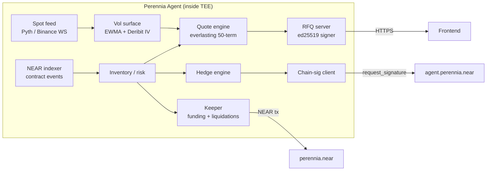

Porting map from the old codebase:

| Old (Perennia) | New (agent) | Effort |
|---|---|---|
| `core/everlasting.py`, `black_scholes.py`, `vol_surface.py` | `agent/pricing/` | Low (rewrite or disclose) |
| `engine/quote_engine.py` | `agent/quoter/` + signing | Medium |
| `engine/risk_engine.py`, `funding_engine.py` | `agent/keeper/` (reads chain, writes txs) | Medium |
| `engine/hedge_engine.py` (3 Pacifica calls) | `agent/hedger/` behind a `HedgeVenue` interface | Medium–High |
| `exchange/*`, `api/routes/collateral.py`, Privy auth | **Deleted.** Replaced by the contract and the wallet | — |
| Postgres options book | **Deleted.** The contract is the source of truth; an optional indexer cache | — |

---

## 8. Frontend changes

| Keep | Replace | Add |
|---|---|---|
| OptionChainPanel, OrderPanel, StrategyBuilder, PayoffDiagram, FundingPanel, ChartPanel | Privy → **NEAR Wallet Selector** (Meteor, HOT, MyNearWallet; social login) | **"Deposit from any chain"** widget (1Click) |
| useOptions, useMarket, useWebSocket | useAuth, useSolanaDeposit, useWalletBalance → NEAR RPC + contract views | **Agent attestation badge** (code hash, TEE quote) |
| Landing page layout | Solana wording | LP vault page (deposit, APY, net delta) |
| | | NEP-245 position transfer UI |

---

## 9. Scope tiers

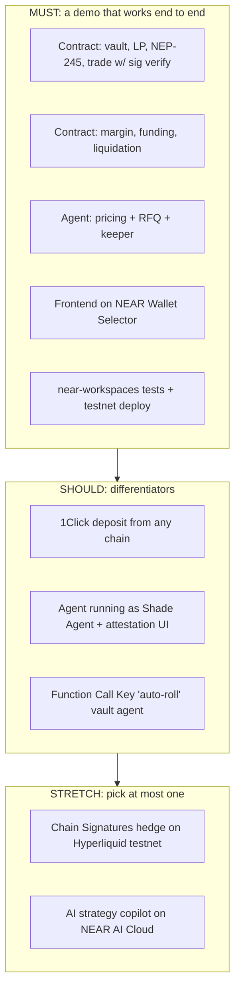

---

## 10. Timeline

```mermaid
gantt
    title Perennia on NEAR, build plan
    dateFormat  YYYY-MM-DD
    axisFormat  %b %d

    section Prep (no repo code)
    Ask organizers re: reuse            :crit, p0, 2026-10-23, 3d
    NEAR accounts, Shade Agent quickstart, 1Click sandbox :p1, 2026-10-24, 6d
    Contract interface spec + fixed-point scheme         :p2, 2026-10-27, 5d
    Demo storyboard                     :p3, 2026-10-30, 2d

    section Contract
    Skeleton: vault, LP, NEP-245, agent registry, trade sig verify :c1, 2026-11-01, 3d
    Margin, funding index, liquidation  :c2, 2026-11-04, 2d
    Testnet deploy + workspaces tests   :c3, 2026-11-06, 2d

    section Agent
    Pricing + vol surface port          :a1, 2026-11-04, 2d
    RFQ signer + keeper                 :a2, 2026-11-05, 2d
    Shade Agent deploy + attestation    :a3, 2026-11-09, 2d

    section Frontend
    Wallet Selector + contract views    :f1, 2026-11-06, 2d
    Trade, positions, funding, LP page  :f2, 2026-11-07, 2d
    1Click deposit widget               :f3, 2026-11-09, 2d

    section Milestones
    Full flow works on testnet          :milestone, m1, 2026-11-08, 0d
    Stretch (hedge OR copilot)          :s1, 2026-11-11, 2d
    Freeze, README, tests green         :crit, z1, 2026-11-13, 1d
    Demo video, X post, submit          :crit, z2, 2026-11-14, 1d
```

| Days | Goal | Exit criterion |
|---|---|---|
| Oct 23–31 | Prep | Reuse question answered; interface spec written |
| Nov 1–3 | Contract core | `trade()` passes signature and margin tests |
| Nov 4–5 | Risk logic + agent pricing | Funding and liquidation tests pass |
| Nov 6–8 | Frontend + integration | **Deposit → trade → funding → withdraw works on testnet** |
| Nov 9–10 | Differentiators | Attestation visible; 1Click deposit works |
| Nov 11–12 | One stretch goal | Demo-able or cut |
| Nov 13 | Freeze | README, diagrams, tests green, video recorded |
| Nov 14 | Submit | X post + form, well before 23:59 UTC |

---

## 11. Judging strategy

| Judge / criterion | What to show |
|---|---|
| **AI judges (Claude Code, Codex)** | A clean public repo, one-command setup, passing CI, accurate README, contract tests, no stale docs |
| **Kain Warwick (Synthetix)** | Funding design, LP risk under a crash, liquidation cascade handling, insurance fund |
| **Illia Polosukhin (NEAR)** | Real use of Intents, Chain Signatures, Shade Agents, NEP-245 |
| **Technical implementation** | Fixed-point contract math, signature-verified RFQ, attested agent |
| **Originality** | The first everlasting-options venue on NEAR; options as NEP-245 tokens |
| **Sustainability** | Revenue: spread + funding skew + LP vault fees |

**Demo script (2–3 minutes):**

1. Connect a NEAR wallet (social login).
2. Deposit SOL from Phantom; it arrives as USDC in the vault through NEAR Intents.
3. Buy an everlasting ETH call with a signed quote, and show the verification on the explorer.
4. Show the agent's TEE attestation badge.
5. Fast-forward: funding settles on-chain from a keeper tx.
6. The agent hedges its delta (Chain Signatures, if built).
7. Transfer the position token to another account (NEP-245).

---

## 12. Risks and mitigations

| Risk | Impact | Mitigation |
|---|---|---|
| Reuse rule disqualifies the project | Fatal | Ask the organizers; fresh repo; disclose prior work |
| Contract gas for margin | High | Max 16 positions per account; 6 scenarios on-chain |
| Shade Agent framework is unaudited / new | Medium | It's a hackathon; say so in the README; fall back to a plain agent key |
| Hyperliquid via Chain Signatures is complex | Medium | Stretch only; hedge with a simulated venue as fallback |
| Oracle availability on testnet | Medium | Agent-signed price bounded by Pyth when available |
| Scope creep | High | Tier 1 must be frozen by Nov 8 |

---

## 13. Submission checklist

- [ ] Public GitHub repo (built Nov 1–14)
- [ ] README: pitch, architecture diagrams, threat model, setup, testnet contract addresses
- [ ] Contracts deployed on testnet (and mainnet if possible)
- [ ] Demo video, 2–3 minutes
- [ ] X post saying it was **built at NEAR HACKATHON**, with the video
- [ ] Form: name, lead, email, team size, tracks (**Unstoppable DeFi**, AI Security & Defense, Agent Economy), NEAR wallet, repo link, X link, description (20–2,000 characters)
- [ ] Submitted before **Nov 14, 23:59 UTC**

---

### References

- NEAR Hackathon: https://nearhackathon.com/
- Shade Agents: https://docs.near.org/ai/shade-agents/concepts/framework-overview
- NEAR Intents / 1Click: https://docs.near-intents.org/near-intents
- NEAR docs index: https://docs.near.org/llms.txt
