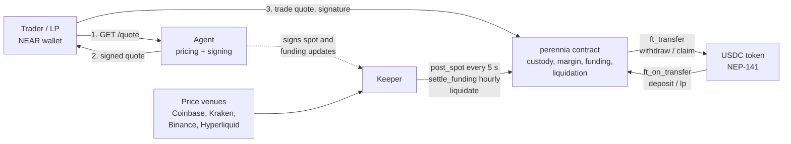

# Perennia on NEAR

Everlasting options on NEAR: calls and puts that never expire. A buyer pays a small funding amount every hour instead of buying a dated contract and rolling it. A NEAR contract holds all the money and enforces margin. An off-chain agent proposes prices by signing quotes, and the contract checks every one of them.

Built at NEAR HACKATHON, Nov 1 to 14, 2026. Draft README for the submission repo (#41).

> **Status, Nov 11.** The contract, the agent and the app are written and tested locally. **Nothing is deployed yet**, so there are no contract addresses, and no part of the system has run against a live network. The TEE deployment and the hedge are not built. The "Status" table at the end is the accurate picture.

## Why everlasting, and why a contract plus an agent

- **No expiry, no rolling.** One series per strike. Liquidity is not split across dates.
- **The contract cannot price options.** Black-Scholes on chain is expensive and needs a vol input someone has to choose. So pricing lives in an agent.
- **The agent cannot take money.** It only signs messages. The contract verifies the signature and then checks the numbers against its own limits before anything moves.

## Architecture



| Part | Where | What it does |
|---|---|---|
| Contract | `contracts/perennia` (Rust, near-sdk) | Holds USDC. Trader collateral, LP vault with shares, trades against signed quotes, margin for traders and for the vault, hourly funding, liquidation, pause |
| Agent | `agent/` (Python) | Prices the chain, signs quotes, posts spot, settles funding, scans for liquidations, serves the HTTP API |
| App | `app/` (React, Vite) | Wallet login, deposit and withdraw, option chain, trade ticket, strategies, positions, funding, LP vault, cross-chain deposit through NEAR Intents |
| Test USDC | `contracts/test-usdc` | Mintable 6-decimal token for testnet |

### A trade

1. The app asks the agent for a quote: series, side, size, taker.
2. The agent prices it from the **contract's own cached spot**, checks that the vault can afford it, and signs `Quote { series, taker, side, size, price, nonce, expiry }`.
3. The trader submits it. The contract checks, in order: caller is the taker, not expired and not dated too far ahead, signature from a registered key, size and price in range, **price inside a band around intrinsic value**, nonce unused, then margin for the trader and the risk limit for the vault after the trade. Any failure reverts the whole transaction.

### Funding

Every hour the keeper posts a signed mark and rate per series. The contract clamps the rate, checks the mark against the band, and adds `rate x mark` to a cumulative per-contract index. An account pays or receives `size x (index now - index at entry)` the next time it is touched.

The agent charges 1/24 of time value per hour, `(mark - intrinsic) / 24`, and prices to match: the option is worth a basket of ordinary options with weights `(1/24)(23/24)^(n-1)` at hourly maturities, an average life of one day. The price and the funding rate come from one parameter so that they cannot disagree (`agent/README.md`, "Pricing").

## Threat model

What each party can and cannot do. "Bounded" means the contract enforces a limit, not that the risk is zero.

| Party | Can | Cannot |
|---|---|---|
| **Trader** | Trade at a signed price, withdraw free collateral to their own account | Withdraw margin backing a short; reuse or alter a quote; use someone else's quote |
| **LP** | Deposit, redeem at the share price after a cooldown | Redeem capital that backs open risk |
| **Agent key** | Set prices, spot and funding **inside the contract's bands** | Move funds; quote outside intrinsic -0.2% / +4% of spot; move spot more than 10% between fresh posts; charge more than 5% of mark per hour; replay any message |
| **Keeper** | Relay signed spot and funding, call `liquidate`; delay them by going offline | Forge them, or change a number |
| **Owner** | Pause deposits and trading, set parameters within validated ranges, rotate agent keys, list series | Move user funds; block withdrawals, claims or liquidations by pausing |
| **Anyone** | Liquidate an account below the liquidation ratio | Liquidate a healthy one |

Controls, all in `contracts/perennia/src/lib.rs`:

- **Custody.** No method lets the owner or the agent transfer user funds. Withdrawals pay the caller only, debit before the transfer and refund in a callback if it fails.
- **Signatures.** ed25519 over `sha256(domain || len(contract id) || contract id || borsh(message))`. The domain separates quote, spot and funding messages; the contract id stops a signature for one deployment being used on another.
- **Replay.** Per-account increasing nonces, increasing spot sequence numbers, strictly increasing funding epochs.
- **Arithmetic.** Integer fixed-point, checked, rounding in the vault's favour. No floats on chain.
- **Solvency invariant.** Trader cash + vault cash + insurance + pending LP claims = net USDC received. A 2,000-step random test checks it after every operation.
- **Circuit breaker.** If vault cash plus insurance goes negative, withdrawals halt until it is recapitalised.

### Known weaknesses

1. **A compromised agent key can trade against the vault at the edge of the band** until the vault's risk limit stops it. The band is wide (up to 4% of spot above intrinsic with the testnet preset) because it has to hold the fair price in a volatile market. The owner rotating keys is the response. A band around the last attested mark and a per-epoch loss cap would narrow it; neither is built.
2. **Spot is agent-signed.** There is no independent oracle on chain. The feed takes the median of four venues and refuses to post when they disagree, but that logic runs off chain.
3. **A quote is a short free option.** A taker can hold a signed quote for its lifetime (28 s with the preset) and use it only if spot moved their way. The spread is the only compensation.
4. **Stale marks.** Between funding settlements, longs are valued at intrinsic and shorts at the last mark clamped to the band. Equity is conservative on both sides, but the LP share price can lag fast moves in time value.
5. **The vault is not hedged.** LPs carry the net delta of the book. The agent reports the hedge target (`/inventory`); nothing trades it.
6. **Liquidation depends on a watch list.** The contract cannot enumerate accounts, so the keeper watches the accounts the agent has quoted for.
7. **No TEE yet.** The plan is to run the agent as a Shade Agent so the code that holds the key is attested. Today it is an ordinary process and the key is an environment variable.
8. **Margin shocks are not calibrated**, and the contract is unaudited.

## Run it

```bash
make near-setup      # app and agent dependencies
make near-test       # contract, test token, app and agent tests
make near-dev        # app on http://localhost:3001 in demo mode: no chain, no wallet
```

Demo mode simulates the contract and the market in the browser, with the same checks, rounding and error strings as the contract. It shows a `DEMO` badge.

Testnet, from a funded owner account (steps in `agent/README.md`):

```bash
cp agent/.env.example agent/.env    # owner, agent and keeper keys; never commit this file
make near-wasm                      # build both contracts
make near-bootstrap                 # deploy, configure, list series, seed liquidity
make near-agent                     # quote server + keeper on :8787
```

Then set `VITE_CONTRACT_ID`, `VITE_USDC_ID` and `VITE_AGENT_URL` in `app/.env`.

## Status

| Piece | State |
|---|---|
| Contract | 71 unit tests, clippy clean, builds to wasm. Not deployed. No sandbox tests, no gas numbers |
| Test USDC | 5 unit tests. Not deployed |
| Agent: pricing, quotes, keeper, API | 110 tests against an in-memory stand-in for the contract. Not run live |
| Wire format | Byte-for-byte parity between the contract, the agent and the app, signatures included |
| Margin | The app's and the agent's ports match the contract on a 2,697-case generated fixture |
| NEAR transactions | The agent's encoder matches `@near-js/transactions` byte for byte; a public testnet node parsed one |
| App | 35 tests, type-checks and builds. Works end to end in demo mode |
| Cross-chain deposit | Live 1Click quotes; delivery is mainnet only |
| TEE (Shade Agent), hedging, NEP-245 position tokens | Not built |

## Prior work

The option pricing math is ported from our earlier project, which ran on a different chain: Black-Scholes, the everlasting series and the skew/smile shape (`agent/perennia_agent/pricing.py`, `app/src/lib/pricing.ts`, from `core/black_scholes.py`, `core/everlasting.py` and `core/vol_surface.py`). Everything else in `contracts/`, `agent/` and `app/` was written during the hackathon window.
