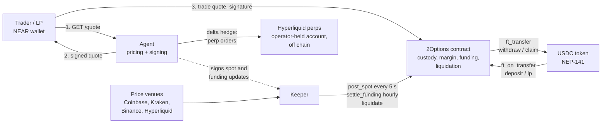

<p align="center"></p>

# 2Options on NEAR

Everlasting options on NEAR: calls and puts that never expire. A buyer pays a small funding amount every hour instead of buying a dated contract and rolling it. A NEAR contract holds all the money and enforces margin. An off-chain agent proposes prices by signing quotes, and the contract checks every one of them.

Built at NEAR HACKATHON, Nov 1 to 14, 2026. Tracks: **Unstoppable DeFi**, AI Security & Defense.

> **Status, Nov 14.** Deployed and trading on NEAR testnet. A scripted end-to-end run passes 34 checks with real transactions. The agent hedges the vault's delta with perps on Hyperliquid testnet, and a keeper liquidation has run live. Not built: the TEE deployment of the agent and transferable position tokens. Two changes from Nov 14 (longs must pay their premium in full and can be liquidated when they cannot pay funding) are verified on a second testnet deployment; the shared one below needs a code upgrade to pick them up. The "Status" table below is the accurate picture.

| Testnet | |
|---|---|
| Contract | `contract.twooptions.testnet` |
| Test USDC (faucet: 2,000 per account per day; worthless) | `usdc.twooptions.testnet` |

## Prior work, disclosed

This repository holds only work built for the hackathon; its history begins on Nov 2, 2026. Before the hackathon we built an everlasting-options venue on a different chain (Pacifica, on Solana), in [gks2022004/nerf](https://github.com/gks2022004/nerf/tree/00fe59b). Nothing here imports or builds against it. These pieces were carried over as adapted copies:

- **Pricing math.** The Black-Scholes and everlasting-series code in `agent/twooptions_agent/pricing.py` and `app/src/lib/pricing.ts` follows [`core/black_scholes.py`](https://github.com/gks2022004/nerf/blob/00fe59b/core/black_scholes.py) and [`core/everlasting.py`](https://github.com/gks2022004/nerf/blob/00fe59b/core/everlasting.py). The NEAR agent changes the model: the series weights follow the funding rule the contract settles (`agent/README.md`, "Pricing").
- **The app's look.** The earlier frontend's visual design is reused on purpose:
  - copied with small edits: the landing page (`app/src/LandingPage.tsx`, copy updated for NEAR), the TradingView chart panel (`app/src/components/ChartPanel.tsx`), `app/src/hooks/useMountEffect.ts`, and the colour tokens in `app/src/theme.tsx`, from [`frontend/src`](https://github.com/gks2022004/nerf/tree/00fe59b/frontend/src);
  - rewritten for NEAR to the same layout and styling: the header, the option chain, the order panel, the tabbed positions panel and the payoff chart.

Everything else was written during the hackathon: the contract, the test token, the agent (quoter, keeper, deploy tooling) and every part of the app behind its look (wallet login, contract views and transactions, signed-quote trading, margin preview, vault, funding, cross-chain deposit, agent badge).

### Libraries and tools

- Contract: `near-sdk`, `near-contract-standards` (the test token), `ed25519-dalek` (tests only).
- Agent: Python standard library and `cryptography`. Dev: `pytest`, `ruff`, `mypy`. The Hyperliquid client signs with its own Keccak-256, msgpack and EIP-712 code; the official `hyperliquid-python-sdk` is used only to generate the test vectors that code is checked against (`agent/scripts/hl_vectors.py`), never at run time.
- App: React, Vite, TypeScript, NEAR Wallet Selector (Meteor, HOT, MyNearWallet), `@near-js/transactions`, `@noble/curves`, `@noble/hashes`, `@scure/base`, Recharts, Zustand, Sonner, Lucide.
- Services: NEAR Intents 1Click API (cross-chain deposit quotes), public NEAR RPC (FastNEAR, dRPC), spot prices from Coinbase, Kraken, Binance and Hyperliquid, and Hyperliquid's perp exchange for the delta hedge.
- AI assistance: parts of the code, tests and documentation were written with Claude Code and reviewed by the team.

## Why everlasting, and why a contract plus an agent

- **No expiry, no rolling.** One series per strike. Liquidity is not split across dates.
- **The contract cannot price options.** Black-Scholes on chain is expensive and needs a vol input someone has to choose. So pricing lives in an agent.
- **The agent cannot take money.** It only signs messages. The contract verifies the signature and then checks the numbers against its own limits before anything moves.

## Architecture



| Part | Where | What it does |
|---|---|---|
| Contract | `contracts/twooptions` (Rust, near-sdk) | Holds USDC. Trader collateral, LP vault with shares, trades against signed quotes, margin for traders and for the vault, hourly funding, liquidation, pause |
| Agent | `agent/` (Python) | Prices the chain, signs quotes, posts spot, settles funding, liquidates accounts that can no longer carry their positions, hedges the vault's delta on Hyperliquid, serves the HTTP API |
| App | `app/` (React, Vite) | Wallet login, deposit and withdraw, option chain, trade ticket, strategies, positions, funding, LP vault with the hedge, a live status page, cross-chain deposit through NEAR Intents |
| Test USDC | `contracts/test-usdc` | 6-decimal token for testnet: rate-limited faucet (2,000 per account per day), owner-only mint |

### A trade

1. The app asks the agent for a quote: series, side, size, taker.
2. The agent prices it from the **contract's own cached spot**, checks that the vault can afford it, and signs `Quote { series, taker, side, size, price, nonce, expiry }`.
3. The trader submits it. The contract checks, in order: caller is the taker, not expired and not dated too far ahead, signature from a registered key, size and price in range, **price inside a band around intrinsic value**, nonce unused, then margin for the trader and the risk limit for the vault after the trade. Any failure reverts the whole transaction.

### Funding

Every hour the keeper posts a signed mark and rate per series. The contract clamps the rate, checks the mark against the band, and adds `rate x mark` to a cumulative per-contract index. An account pays or receives `size x (index now - index at entry)` the next time it is touched.

The agent charges 1/24 of time value per hour, `(mark - intrinsic) / 24`, and prices to match: the option is worth a basket of ordinary options with weights `(1/24)(23/24)^(n-1)` at hourly maturities, an average life of one day. The price and the funding rate come from one parameter so that they cannot disagree (`agent/README.md`, "Pricing").

## Threat model

What each party can and cannot do. "Bounded" means the contract enforces a limit, not that the risk is zero.

| Party | Can | Cannot |
|---|---|---|
| **Trader** | Trade at a signed price, withdraw free collateral to their own account | Buy an option without the cash to pay for it; withdraw margin backing a short; reuse or alter a quote; use someone else's quote |
| **LP** | Deposit, redeem at the share price after a cooldown | Redeem capital that backs open risk |
| **Agent key** | Set prices, spot and funding **inside the contract's bands** | Move funds; quote outside intrinsic -0.2% / +4% of spot; quote more than 1% of spot (plus spot's move since) from the last funding mark; make the vault pay out more than 10% of its cash per hour; move spot more than 10% between fresh posts; charge more than 5% of mark per hour; replay any message |
| **Keeper** | Relay signed spot and funding, call `liquidate`; delay them by going offline | Forge them, or change a number |
| **Owner** | Pause deposits and trading, set parameters within validated ranges, rotate agent keys, list series | Move user funds; block withdrawals, claims or liquidations by pausing |
| **Anyone** | Liquidate an account below the liquidation ratio, or one whose equity is negative once the funding it owes is counted | Liquidate a healthy one |
| **Hedge operator** | Trade perps in an exchange account it holds, to offset the vault's delta | Touch funds in the contract. The hedge account itself is trusted: it is off chain and its profit and loss is not in the vault |

Controls, all in `contracts/twooptions/src/lib.rs`:

- **Custody.** No method lets the owner or the agent transfer user funds. Withdrawals pay the caller only, debit before the transfer and refund in a callback if it fails.
- **Signatures.** ed25519 over `sha256(domain || len(contract id) || contract id || borsh(message))`. The domain separates quote, spot and funding messages; the contract id stops a signature for one deployment being used on another.
- **Replay.** Per-account increasing nonces, increasing spot sequence numbers, strictly increasing funding epochs.
- **Arithmetic.** Integer fixed-point, checked, rounding in the vault's favour. No floats on chain.
- **Solvency invariant.** Trader cash + vault cash + insurance + pending LP claims = net USDC received. A 2,000-step random test checks it after every operation.
- **Circuit breaker.** If vault cash plus insurance goes negative, withdrawals halt until it is recapitalised.
- **Longs pay their way.** An everlasting long is never fully paid: it owes funding every hour. A buy must be covered by cash in full, and a long whose cash can no longer pay its funding is closed at the mark by anyone, with a fee on the value closed (0.5% to the caller, 0.5% to insurance). Before Nov 14 neither rule existed: a long had no margin requirement, so it could be opened on credit and never liquidated.

### Known weaknesses

1. **A compromised agent key can still cost the vault up to 10% of its cash per hour.** Round trips are the attack: buy from the vault at the bottom of the allowed price range and sell straight back at the top. Each round trip *lowers* the vault's risk, so the vault's risk limit never stops it. Two contract rules bound it: every trade price must sit within 1% of spot, plus spot's move since, of the series' last funding mark (an option's price moves no more than spot does, so honest quotes fit), and the vault's net payout to traders per funding hour is capped at 10% of its cash at the start of that hour. The response to a leaked key is the owner pausing trading and rotating the key (`set_agent_keys`) within that hour. Running the agent in a TEE would remove the operator from the trust model; that is not built (NEAR's Shade Agent Framework is deprecated, and its listed alternative, OutLayer, cannot host a quote server).
2. **Spot is agent-signed.** There is no independent oracle on chain. The feed takes the median of four venues and refuses to post when they disagree, but that logic runs off chain.
3. **A quote is a short free option.** A taker can hold a signed quote for its lifetime (28 s with the preset) and use it only if spot moved their way. The spread is the only compensation.
4. **Stale marks.** Between funding settlements, longs are valued at intrinsic and shorts at the last mark clamped to the band. Equity is conservative on both sides, but the LP share price can lag fast moves in time value.
5. **The hedge is off chain and trusted.** The agent offsets the vault's net delta with a perp position on Hyperliquid (`agent/twooptions_agent/hedger.py`). That position sits in an exchange account the operator holds, not in the contract; its profit and loss does not flow into vault equity or the LP share price, and nothing on chain proves it exists. It lowers the price risk LPs carry, at a cost: each rebalance crosses the venue's spread and pays its fee, and a vault that is short options buys high and sells low as it re-hedges. To keep that cost bounded the hedger leaves a no-trade band that widens with the book's gamma (the delta drift of a 0.5% move in spot), and the vault carries the drift inside it. It only hedges delta; LPs still carry the book's gamma and vega, and the quoter's spread does not yet price in the cost of the hedge. The app shows the hedge with this caveat.
6. **Liquidation depends on a watch list.** The contract cannot enumerate accounts, so the keeper watches the accounts the agent has quoted for.
7. **Longs have no funding buffer.** A long becomes liquidatable only when its equity (cash plus intrinsic value, less funding owed) is negative. The cushion at that moment is the option's remaining time value, about a day of funding. If the keeper is away for longer, the unpaid funding can exceed what the position is worth and the difference falls on insurance and then the vault. A reserve of a few hours of funding in the long's requirement would close that; it changes the margin code and its two ports, and was not done.
8. **No TEE yet.** The plan is to run the agent as a Shade Agent so the code that holds the key is attested. Today it is an ordinary process and the key is an environment variable.
9. **Margin shocks are not calibrated**, and the contract is unaudited.

## Run it

```bash
make near-setup      # app and agent dependencies
make near-test       # contract, test token, app and agent tests
make near-dev        # app on http://localhost:3001 in demo mode: no chain, no wallet
```

Demo mode simulates the contract and the market in the browser, with the same checks, rounding and error strings as the contract. It shows a `DEMO` badge.

To run your own testnet deployment from a funded owner account (steps in `agent/README.md`), or point the app at ours by setting only the three `VITE_` values:

```bash
cp agent/.env.example agent/.env    # owner, agent and keeper keys; never commit this file
make near-wasm                      # build both contracts
make near-bootstrap                 # deploy, configure, list series, seed liquidity
make near-agent                     # quote server + keeper on :8787
cd agent && uv run python scripts/e2e_testnet.py <account.testnet>       # the 34-check live run
cd agent && uv run python scripts/liquidation_demo.py <account.testnet>  # a live liquidation of a long
cd agent && uv run python scripts/hedge_smoke.py --trade                 # a round trip on Hyperliquid testnet
```

Hedging is off until `HYPERLIQUID_PRIVATE_KEY` is set in `agent/.env` (`agent/README.md`, "Hedging").

Then set `VITE_CONTRACT_ID`, `VITE_USDC_ID` and `VITE_AGENT_URL` in `app/.env`.

## Status

| Piece | State |
|---|---|
| Contract | Deployed on testnet. 84 unit tests, clippy clean. No sandbox tests, no gas numbers. Unaudited. **The shared deployment runs the code from before Nov 14** and needs `admin upgrade` (code only, no migration) for the long-side rules below |
| Test USDC | Deployed on testnet. 9 unit tests (faucet limit, owner-only mint, migration) |
| Agent: pricing, quotes, keeper, hedger, API | Running against testnet: posts spot every 5 s, settles funding hourly, signs quotes, liquidates, hedges. Fails over between RPC endpoints. 196 unit tests |
| End to end | `agent/scripts/e2e_testnet.py`: 34 checks with real transactions (33 while the test account's daily faucet claim is cooling down): faucet and its daily limit, deposit, a buy on credit refused, trades, rejected replays and forgeries, a validly signed price far from the funding mark, two-leg batch, withdraw, LP deposit and redeem, close-out, solvency. All 34 passed on Nov 14 against the upgraded contract on the second deployment; 33 of 33 passed on the shared one on Nov 13 |
| Wire format | Byte-for-byte parity between the contract, the agent and the app, signatures included |
| Margin | The app's and the agent's ports match the contract on a 2,697-case generated fixture |
| NEAR transactions | The agent's own encoder matches `@near-js/transactions` byte for byte |
| Status page | `#/status` in the app: one verdict per component (contract, price feed, ledger, quote server, agent key, keeper, funding, vault, hedge) and an overall one, read live from the contract and the agent's `/health`. An outage is declared only when something needed to trade is down. `cd app && bun scripts/live_status.ts` prints the same verdict from the command line |
| App | 78 tests, type-checks and builds. Demo mode works end to end. On testnet: wallet sign-in, faucet, deposit, trading without a wallet popup (a limited key), withdraw and LP deposit and redeem have been used by hand |
| Liquidation | Ran live on Nov 14 on the second deployment (`contract.e2e-owner-459fc447.testnet`), with no parameter changed and no staged price: the keeper closed a long that could not pay its funding ([`A1YzFhNk…`](https://testnet.nearblocks.io/txns/A1YzFhNkUxQwgVv2RFq8SnNeZRb9HR7KwHEp7DTbTRz6)), and the account's balance matched cash - funding + value at the mark - fees to the micro. `agent/scripts/liquidation_demo.py` repeats it. The same deployment was first run on the earlier code to show the hole: an account with 1 USDC bought 100 USDC of calls ([`GgeZAz52…`](https://testnet.nearblocks.io/txns/GgeZAz52cC5sMMi6WLFwWQ5dZvbqyFysEcJQavp3fNA9)); after the in-place upgrade the keeper closed it ([`BsWib2NA…`](https://testnet.nearblocks.io/txns/BsWib2NATibbzgd1pipuB8CyuaWdWCFK18pD9ayxRhTk)). Liquidation of a short is unit-tested only |
| Hedging | Ran live on Nov 14: a trader bought 2 calls on NEAR testnet and the agent bought 0.8286 ETH of perp on Hyperliquid testnet about 15 s later and flattened it with a reduce-only order when the calls were sold back. Signing is checked byte for byte against the official SDK on 48 vectors. The hedge account is the operator's and off chain (weakness 5) |
| LP claim | Unit-tested. Not exercised on testnet (one-hour cooldown) |
| Cross-chain deposit | Live 1Click quotes; delivery is mainnet only |
| TEE (Shade Agent), NEP-245 position tokens | Not built |

