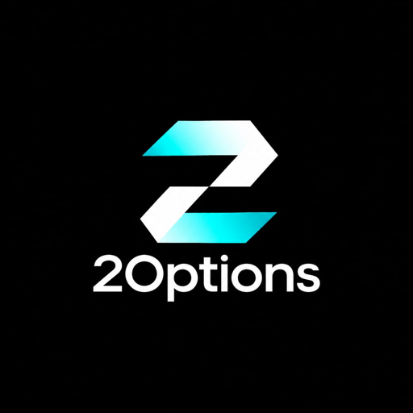
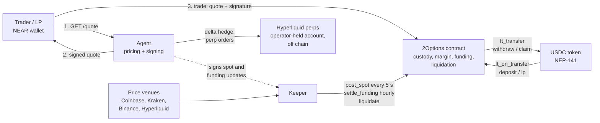

<p align="center"></p>

# 2Options

**Options that never expire, settled on NEAR.**

2Options is an everlasting-options exchange. A call or put has no expiry date: instead of buying a dated contract and rolling it, the holder pays a small funding amount every hour for as long as they keep it. A NEAR smart contract holds every dollar, enforces margin and settles funding. An off-chain agent prices the options and signs quotes, and the contract checks each quote against its own limits before anything moves.

- **Live app:** https://2options.xyz (NEAR testnet)
- **Agent API:** https://api.2options.xyz ([`/status` page in the app](https://2options.xyz/#/status) shows every component's health)
- **Hackathon:** NEAR Hackathon, 1–14 November 2026. Tracks: **Unstoppable DeFi** (`defi`) and **AI Security & Defense** (`security`).

| Testnet | Account |
|---|---|
| Options contract | `contract.twooptions.testnet` |
| Test USDC (no value) | `usdc.twooptions.testnet` |

## Try it

1. Open https://2options.xyz, press **Launch app** and connect a NEAR testnet wallet (Meteor, HOT or MyNearWallet).
2. Click **FAUCET** in the header: 2,000 test USDC, once a day per account.
3. **Deposit** it as collateral, click an **Ask** in the option chain to buy (or a **Bid** to sell), get a firm quote and confirm.

After the first deposit, trades need no wallet pop-up: the app adds a limited key that can only call the contract's trading methods. On this shared deployment each trade is capped at 0.1 contracts so the hedge stays small (see [Deployment](#deployment)).

## How it works



- **One series per strike, forever.** Liquidity is not split across expiry dates, and nobody has to roll.
- **The contract does not price options.** Black-Scholes on chain is expensive and needs a volatility someone must choose, so pricing lives in the agent. The contract only checks.
- **The agent cannot take money.** It signs messages; it holds no user funds and no method lets it move them.

| Part | Where | What it does |
|---|---|---|
| Contract | `contracts/twooptions` (Rust, near-sdk) | Holds USDC. Trader collateral, an LP vault with shares, trades against signed quotes, margin for traders and for the vault, hourly funding, liquidation, pause |
| Agent | `agent/` (Python: standard library plus `cryptography`) | Prices the chain, signs quotes, posts spot, settles funding, liquidates, hedges the vault's delta on Hyperliquid, serves the HTTP API |
| App | `app/` (React, Vite) | Wallet login, faucet, deposit and withdraw, option chain, trade ticket, multi-leg strategies, positions and history, funding, LP vault, status page, deposit from other chains via NEAR Intents |
| Test USDC | `contracts/test-usdc` | 6-decimal testnet token with a rate-limited faucet |

**A trade.** The agent prices the quote from the contract's own cached spot and signs `Quote { series, taker, side, size, price, nonce, expiry }`. The contract then checks, in order: the caller is the taker, the quote has not expired, the signature is from a registered key, size and price are in range, the price is inside a band around intrinsic value and near the last funding mark, the nonce is unused, and margin holds for both the trader and the vault after the trade. Any failure reverts the whole transaction.

**Funding.** Every hour the keeper posts a signed mark and rate per series. The contract clamps the rate, checks the mark, and adds `rate × mark` to a cumulative index; an account pays or receives `size × (index now − index at entry)` when it is next touched. The agent charges 1/24 of time value per hour and prices options to match, so price and funding come from one parameter and cannot disagree (`agent/README.md`, "Pricing").

**Liquidation.** Anyone may close an account whose equity is below 1.15× its margin requirement, or negative once owed funding is counted. The contract indexes its accounts and answers, a page at a time, which ones `liquidate` would accept (`list_liquidatable`), so the keeper covers every account with the contract's own test.

**Hedging.** The vault is the counterparty to every trade. The agent offsets the vault's net delta with an ETH perp on Hyperliquid, re-hedging only when the gap is worth more than the trading cost. The hedge lives in an exchange account the operator holds, outside the contract (see [Known limitations](#known-limitations)).

## Security

What each party can and cannot do. "Bounded" means the contract enforces a limit, not that the risk is zero.

| Party | Can | Cannot |
|---|---|---|
| **Trader** | Trade at a signed price; withdraw free collateral to their own account | Buy without the cash to pay; withdraw margin backing a short; reuse, alter or borrow someone else's quote |
| **LP** | Deposit; redeem at the share price after a cooldown | Redeem capital that backs open risk |
| **Agent key** | Set prices, spot and funding inside the contract's bands | Move funds; quote outside intrinsic −0.2% / +4% of spot; quote more than 1% of spot (plus spot's move since) from the last funding mark; make the vault pay out more than 10% of its cash per hour; move spot more than 10% between fresh posts; charge more than 5% of mark per hour; replay a message |
| **Keeper** | Relay signed spot and funding; call `liquidate`; delay them by going offline | Forge or change a number |
| **Owner** | Pause deposits and trading; set parameters within validated ranges; rotate agent keys; list series | Move user funds; block withdrawals, claims or liquidations |
| **Anyone** | Liquidate an account that fails the test above | Liquidate a healthy one |
| **App's trading key** | Call `trade`, `withdraw` and LP redeem/claim for its own account, within a NEAR allowance | Call any other contract or method, or attach a deposit |

Controls, all in `contracts/twooptions/src/lib.rs`:

- **Custody.** No method lets the owner or the agent transfer user funds. Withdrawals pay the caller only, debit first, and refund in a callback if the transfer fails.
- **Signatures.** ed25519 over `sha256(domain ‖ len(contract id) ‖ contract id ‖ borsh(message))`. The domain separates quote, spot and funding messages; the contract id stops a signature for one deployment working on another.
- **Replay.** Per-account increasing nonces, increasing spot sequence numbers, strictly increasing funding epochs.
- **Arithmetic.** Checked integer fixed-point, rounding in the vault's favour. No floats on chain.
- **Solvency invariant.** Trader cash + vault cash + insurance + pending LP claims = net USDC received, checked after every step of a 2,000-step random test.
- **Circuit breaker.** If vault cash plus insurance goes negative, withdrawals halt until it is recapitalised.

### Known limitations

1. **A stolen agent key can cost the vault up to 10% of its cash per hour.** Round trips at the edges of the allowed price range are the attack; the mark band and the hourly payout cap bound it, and the owner can pause and rotate the key (`contracts/README.md`, "Limits on the agent key").
2. **Spot is agent-signed.** There is no independent oracle on chain. The feed takes the median of four venues and refuses to post when they disagree, but that runs off chain.
3. **The hedge is off chain and trusted.** It sits in an operator-held exchange account; its profit and loss does not flow into the vault, and nothing on chain proves it exists.
4. **A quote is a short free option.** A taker can hold a signed quote for its lifetime (under 30 s) and use it only if spot moved their way. The spread is the only compensation.
5. **Marks go stale between funding settlements.** Equity is valued conservatively, but the LP share price can lag fast moves in time value.
6. **Longs have no funding buffer.** A long becomes liquidatable only at negative equity; if no keeper runs for about a day, unpaid funding can exceed the position's value, and the difference falls on insurance, then the vault.
7. **The agent runs as an ordinary process,** on a cloud VM. A container image with TEE attestation (an Intel TDX quote bound to the signing key, `deploy/phala/`) is built and tested but not deployed.
8. **Deposits from other chains deliver on mainnet only.** On testnet the app shows a live NEAR Intents quote and stops there.
9. **Margin shocks are not calibrated, and the contract is unaudited.** Testnet only.

## Deployment

| Piece | Where | Cost |
|---|---|---|
| App | Vercel, at `2options.xyz` (`app/vercel.json`) | free (Hobby) |
| Agent: quotes, keeper, hedger | One Oracle Cloud Always Free VM behind Caddy, at `api.2options.xyz` (`deploy/oracle/`) | free |
| Hedge venue | Hyperliquid testnet | test funds |

The shared deployment caps sizes in the agent so the hedge uses little test money: at most 0.1 contracts per trade, 0.1 per account per series, and 0.25 open across all accounts per underlying; the hedge is capped at $500. Closing a position is always allowed. The limits are agent settings (`TWOOPTIONS_MAX_*`, `HEDGE_MAX_*`), published at `/limits`, and the app shows them on the ticket.

## Run it locally

Needs Rust 1.91 with the `wasm32-unknown-unknown` target, [bun](https://bun.sh) and [uv](https://docs.astral.sh/uv/).

```bash
make near-setup      # app and agent dependencies
make near-test       # contract, test token, app and agent tests
make near-dev        # app on http://localhost:3001 in demo mode: no chain, no wallet
```

Demo mode simulates the contract and the market in the browser with the contract's checks, rounding and error strings, and shows a `DEMO` badge. To point the local app at the shared deployment, set in `app/.env`:

```bash
VITE_NEAR_NETWORK=testnet
VITE_CONTRACT_ID=contract.twooptions.testnet
VITE_USDC_ID=usdc.twooptions.testnet
VITE_AGENT_URL=https://api.2options.xyz
```

To run your own deployment from a funded testnet owner account (details in `agent/README.md`):

```bash
cp agent/.env.example agent/.env    # owner, agent and keeper keys; never commit this file
make near-wasm                      # build both contracts
make near-bootstrap                 # deploy, configure, list series, seed liquidity
make near-agent                     # quote server + keeper on :8787
```

Hedging stays off until `HYPERLIQUID_PRIVATE_KEY` is set. Use one exchange account per agent: two hedgers on one account trade against each other.

## Tests

`make near-test` runs the unit tests of the contract, the test token, the agent and the app. Beyond ordinary cases they check:

- the solvency invariant after every step of a random run, including liquidations;
- that `list_liquidatable` names an account exactly when `liquidate` accepts it;
- byte-for-byte parity of signed messages between the contract, the agent and the app;
- that the agent's and the app's margin code match the contract on a generated fixture, and that the agent's NEAR transaction encoder matches `@near-js/transactions`.

CI (`.github/workflows/near.yml`) runs the same, plus clippy, the wasm build and a check that the parity fixtures match the contract.

Scripts in `agent/scripts/` exercise a live deployment with real testnet transactions:

```bash
cd agent
uv run python scripts/e2e_testnet.py <account.testnet>        # faucet, deposit, trades, rejected forgeries and replays, LP, withdraw
uv run python scripts/liquidation_demo.py <account.testnet>   # a long that cannot pay its funding is closed by the keeper
uv run python scripts/hedge_smoke.py --trade                  # a minimum-size round trip on Hyperliquid testnet
```

## Documentation

| | |
|---|---|
| `contracts/README.md` | Contract interface, units, parameters, upgrades and migrations |
| `agent/README.md` | Agent setup, HTTP API, pricing model, keeper and hedger |
| `app/README.md` | App modes, screens and layout |
| `deploy/oracle/README.md` | The live deployment and how to rebuild it |

## Prior work

The option-pricing math and the app's visual style were adapted from the team's earlier everlasting-options prototype on another chain. Everything NEAR-specific (the contract, the agent, the testnet deployment and the app's NEAR integration) was built during the hackathon window.

## License

MIT
