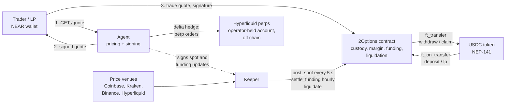

<p align="center"></p>

# 2Options

Everlasting options on NEAR: calls and puts that never expire. Instead of buying a dated contract and rolling it, a holder pays a small funding amount every hour. A NEAR contract holds all funds and enforces margin. An off-chain agent proposes prices by signing quotes, and the contract checks every one before anything moves.

Built at NEAR HACKATHON, 1 to 14 November 2026. Tracks: Unstoppable DeFi, AI Security & Defense.

| Testnet | |
|---|---|
| Contract | `contract.twooptions.testnet` |
| Test USDC (faucet: 2,000 per account per day, no value) | `usdc.twooptions.testnet` |

## How it works

- **No expiry, no rolling.** One series per strike, so liquidity is not split across dates.
- **The contract does not price options.** Black-Scholes on chain is expensive and needs a volatility someone has to choose, so pricing lives in an agent.
- **The agent cannot take money.** It only signs messages. The contract verifies the signature, then checks every number against its own limits.



| Part | Where | What it does |
|---|---|---|
| Contract | `contracts/twooptions` (Rust, near-sdk) | Holds USDC. Trader collateral, an LP vault with shares, trades against signed quotes, margin for traders and for the vault, hourly funding, liquidation, pause |
| Agent | `agent/` (Python, standard library plus `cryptography`) | Prices the chain, signs quotes, posts spot, settles funding, liquidates, hedges the vault's delta on Hyperliquid, serves the HTTP API |
| App | `app/` (React, Vite) | Wallet login, deposit and withdraw, option chain, trade ticket, multi-leg strategies, positions, funding, LP vault, a live status page, deposit from other chains through NEAR Intents |
| Test USDC | `contracts/test-usdc` | 6-decimal token for testnet with a rate-limited faucet |

**A trade.** The app asks the agent for a quote. The agent prices it from the contract's own cached spot and signs `Quote { series, taker, side, size, price, nonce, expiry }`. The trader submits it, and the contract checks in order: the caller is the taker, the quote has not expired, the signature is from a registered key, size and price are in range, the price is inside a band around intrinsic value, the nonce is unused, and margin holds for the trader and for the vault after the trade. Any failure reverts the transaction.

**Funding.** Every hour the keeper posts a signed mark and rate per series. The contract clamps the rate, checks the mark against the band, and adds `rate x mark` to a cumulative index. An account pays or receives `size x (index now - index at entry)` when it is next touched. The agent charges 1/24 of time value per hour and prices to match, so the price and the funding rate come from one parameter and cannot disagree (`agent/README.md`, "Pricing").

**Liquidation.** Anyone may close an account whose equity is below 1.15 times its margin requirement, or negative once the funding it owes is counted. The contract keeps an index of its accounts and answers, a page at a time, which of them it would let be liquidated (`list_liquidatable`). The keeper pages through that view, so every account is covered and the test applied is the contract's own.

## Security

What each party can and cannot do. "Bounded" means the contract enforces a limit, not that the risk is zero.

| Party | Can | Cannot |
|---|---|---|
| **Trader** | Trade at a signed price, withdraw free collateral to their own account | Buy an option without the cash to pay for it; withdraw margin backing a short; reuse or alter a quote; use someone else's quote |
| **LP** | Deposit, redeem at the share price after a cooldown | Redeem capital that backs open risk |
| **Agent key** | Set prices, spot and funding inside the contract's bands | Move funds; quote outside intrinsic -0.2% / +4% of spot; quote more than 1% of spot (plus spot's move since) from the last funding mark; make the vault pay out more than 10% of its cash per hour; move spot more than 10% between fresh posts; charge more than 5% of mark per hour; replay a message |
| **Keeper** | Relay signed spot and funding, call `liquidate`, delay them by going offline | Forge them or change a number |
| **Owner** | Pause deposits and trading, set parameters within validated ranges, rotate agent keys, list series | Move user funds; block withdrawals, claims or liquidations by pausing |
| **Anyone** | Liquidate an account that fails the test above | Liquidate a healthy one |
| **Hedge operator** | Trade perps in an exchange account it holds, to offset the vault's delta | Touch funds in the contract |

Controls, all in `contracts/twooptions/src/lib.rs`:

- **Custody.** No method lets the owner or the agent transfer user funds. Withdrawals pay the caller only, debit before the transfer and refund in a callback if it fails.
- **Signatures.** ed25519 over `sha256(domain || len(contract id) || contract id || borsh(message))`. The domain separates quote, spot and funding messages; the contract id stops a signature for one deployment being used on another.
- **Replay.** Per-account increasing nonces, increasing spot sequence numbers, strictly increasing funding epochs.
- **Arithmetic.** Integer fixed-point, checked, rounding in the vault's favour. No floats on chain.
- **Solvency invariant.** Trader cash + vault cash + insurance + pending LP claims = net USDC received, checked after every step of a 2,000-step random test.
- **Circuit breaker.** If vault cash plus insurance goes negative, withdrawals halt until it is recapitalised.
- **Longs pay their way.** A buy must be covered by cash in full, and a long whose cash can no longer pay its funding is closed at the mark.

### Known limitations

1. **A compromised agent key can cost the vault up to 10% of its cash per hour.** Round trips at the edges of the allowed price range are the attack. Two contract rules bound it: trade prices must stay near the last funding mark, and the vault's net payout per funding hour is capped (`contracts/README.md`, "Limits on the agent key").
2. **Spot is agent-signed.** There is no independent oracle on chain. The feed takes the median of four venues and refuses to post when they disagree, but that logic runs off chain.
3. **A quote is a short free option.** A taker can hold a signed quote for its lifetime (under 30 s) and use it only if spot moved their way. The spread is the only compensation.
4. **Marks go stale between funding settlements.** Equity is valued conservatively on both sides, but the LP share price can lag fast moves in time value.
5. **The hedge is off chain and trusted.** It sits in an exchange account the operator holds. Its profit and loss does not flow into the vault, and nothing on chain proves it exists.
6. **Longs have no funding buffer.** A long becomes liquidatable only at negative equity. If no keeper runs for about a day, unpaid funding can exceed what the position is worth, and the difference falls on insurance and then the vault.
7. **The TEE attests the code, not the key's origin.** When the container runs in an Intel TDX VM (`deploy/phala/`), `/attestation` returns a TDX quote bound to the agent's signing key. The operator supplies that key and so knows it; the limits in item 1 are what bound a leaked key.
8. **Deposits from other chains deliver on mainnet only.** On testnet the app shows a live NEAR Intents quote and stops there.
9. **Margin shocks are not calibrated, and the contract is unaudited.**

## Run it

Needs Rust 1.91 with the `wasm32-unknown-unknown` target, [bun](https://bun.sh) and [uv](https://docs.astral.sh/uv/).

```bash
make near-setup      # app and agent dependencies
make near-test       # contract, test token, app and agent tests
make near-dev        # app on http://localhost:3001 in demo mode: no chain, no wallet
```

Demo mode simulates the contract and the market in the browser with the same checks, rounding and error strings as the contract. It shows a `DEMO` badge.

To run your own testnet deployment from a funded owner account (steps in `agent/README.md`):

```bash
cp agent/.env.example agent/.env    # owner, agent and keeper keys; never commit this file
make near-wasm                      # build both contracts
make near-bootstrap                 # deploy, configure, list series, seed liquidity
make near-agent                     # quote server + keeper on :8787
```

Then set `VITE_CONTRACT_ID`, `VITE_USDC_ID` and `VITE_AGENT_URL` in `app/.env` (`app/.env.example`) and run `make near-dev`. Setting only those three values to the testnet addresses above points the app at the shared deployment. Hedging stays off until `HYPERLIQUID_PRIVATE_KEY` is set (`agent/README.md`, "Hedging").

**One container.** The root `Dockerfile` builds the app and the agent into one image: the agent serves the trade desk at `/`, its API beside it, and runs the keeper. `deploy/phala/README.md` deploys it to an Intel TDX VM.

```bash
docker build -t 2options .
docker run --rm --env-file agent/.env -e HOST=0.0.0.0 -e TWOOPTIONS_DATA_DIR=/data -e TWOOPTIONS_CORS_ORIGINS= -p 8787:8787 2options
# open http://localhost:8787
```

## Tests

`make near-test` runs the unit tests of the contract, the test token, the agent and the app. Beyond ordinary cases they check:

- the solvency invariant after every step of a random run, including liquidations;
- that `list_liquidatable` names an account exactly when `liquidate` accepts it;
- byte-for-byte parity of signed messages between the contract, the agent and the app;
- that the agent's and the app's margin code match the contract on a generated fixture, and that the agent's transaction encoder matches `@near-js/transactions`.

CI (`.github/workflows/near.yml`) runs the same, plus clippy, the wasm build and a check that the parity fixtures match the contract code.

Scripts in `agent/scripts/` exercise a live testnet deployment with real transactions:

```bash
cd agent
uv run python scripts/e2e_testnet.py <account.testnet>        # deposit, trades, rejected forgeries and replays, LP, withdraw
uv run python scripts/liquidation_demo.py <account.testnet>   # a long that cannot pay its funding is closed by the keeper
uv run python scripts/hedge_smoke.py --trade                  # a minimum-size round trip on Hyperliquid testnet
```

## Documentation

| | |
|---|---|
| `contracts/README.md` | Contract interface, units, parameters, upgrades and migrations |
| `agent/README.md` | Agent setup, HTTP API, pricing model, keeper and hedger behaviour |
| `app/README.md` | App modes, screens and layout |
| `deploy/phala/README.md` | Running the container in a TEE |

## Origins

2Options builds on the team's earlier everlasting-options prototype, [nerf](https://github.com/gks2022004/nerf/tree/00fe59b): the option-pricing math and the app's visual design were adapted from it. The contract, the agent and the rest of the app were written for this hackathon.
